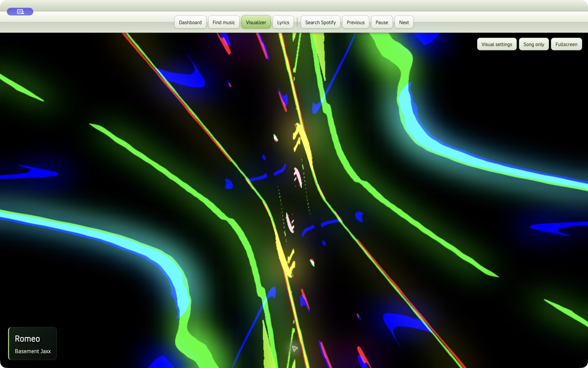
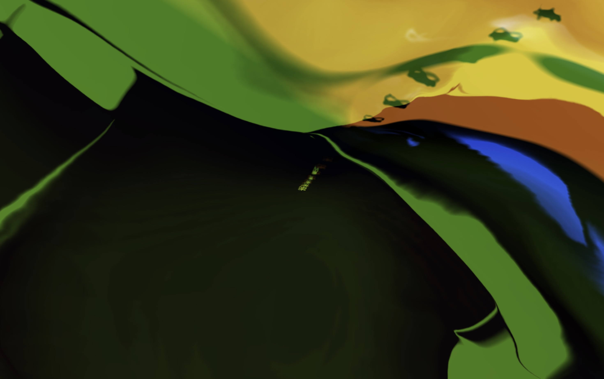

# XboxBlades for Spicetify

An unofficial Xbox 360-style dashboard for Spotify desktop. Browse Spotify songs and playlists, switch between visualizers, read synced lyrics when available, and navigate with a controller that Spotify detects with the standard gamepad layout.

## Screenshots

The fullscreen capture shows an earlier beta.

**MilkDrop visualizer in Spotify**



**Fullscreen visualizer**



## 1. Install Spicetify

Install [Spotify desktop](https://www.spotify.com/download/), open it, and sign in. On a fresh install, leave Spotify open for about a minute so it can create its preferences. Then choose your operating system below. If `spicetify --version` already works, skip to [Install XboxBlades](#2-install-xboxblades).

### macOS

Open **Terminal** and run the official installer.

```sh
curl -fsSL https://raw.githubusercontent.com/spicetify/cli/main/install.sh | sh
```

If you already use Homebrew, you can install with `brew install spicetify-cli`. For Spotify in your Applications folder, set its path with `spicetify config spotify_path "/Applications/Spotify.app/Contents/Resources"`. [Spicetify macOS instructions](https://spicetify.app/docs/getting-started#macos)

### Windows

Open **PowerShell** and run the official installer.

```powershell
iwr -useb https://raw.githubusercontent.com/spicetify/cli/main/install.ps1 | iex
```

If you use WinGet, you can run `winget install Spicetify.Spicetify` instead. [Spicetify Windows instructions](https://spicetify.app/docs/getting-started#windows)

### Linux

Open your **terminal** and run the official installer.

```sh
curl -fsSL https://raw.githubusercontent.com/spicetify/cli/main/install.sh | sh
```

Follow the package-specific setup for your copy of Spotify. APT may need write permissions. Flatpak may need its Spotify install and preferences paths set in Spicetify. If you use Snap Spotify, switch to a supported package such as APT before applying the theme. [Spicetify Linux package setup](https://spicetify.app/docs/getting-started#linux-specific-setup)

Marketplace is optional. Open a fresh terminal after installation if `spicetify` is missing, then run `spicetify --version` to check the install.

## 2. Install XboxBlades

1. Open the [XboxBlades v0.1.4-beta release](https://github.com/amauryca/Spotify-Xbox-Theme/releases/tag/v0.1.4-beta). Under **Assets**, download **XboxBlades-v0.1.4-beta.zip** and extract it.
2. Run `spicetify config-dir` in Terminal or PowerShell. Open **Themes** inside the directory it opens, creating it if needed. If the file manager does not open, `spicetify -c` prints the config file path. Open its parent folder.
3. Copy the extracted **XboxBlades** folder into **Themes**. Check that `theme.js`, `user.css`, and `color.ini` are directly inside `Themes/XboxBlades/`.
4. Run these commands in the same terminal.

   ```text
   spicetify config current_theme XboxBlades color_scheme Blades inject_css 1 inject_theme_js 1
   spicetify backup apply
   ```

5. Open or restart Spotify. The Xbox dashboard opens automatically. Use **Search Spotify** to return to the regular Spotify interface and **Xbox Dashboard** to switch back.

### Update or restore

- **Update XboxBlades.** Replace the files in `Themes/XboxBlades/` with the files from the new release and run `spicetify apply`.
- **After a Spotify update.** Run `spicetify backup apply`. If Spotify and Spicetify versions are incompatible, update Spicetify through the same method you used to install it. [Spicetify update guide](https://spicetify.app/docs/getting-started#updating)
- **Restore Spotify.** Run `spicetify restore` and reopen Spotify.

## Controls

- **Find music** searches Spotify and opens playlists. Choose a song to open its visualizer.
- **Visual settings** contains styles, performance controls, and color adjustments. **Song only** leaves the song label visible. **Fullscreen** hides it. Press Escape to return.
- **Lyrics** displays Spotify lyrics where available.
- **Media → Pictures** imports up to eight local photos as a rotating dashboard background.
- **System → Console Settings** links to Spotify settings and provides live playback controls.
- For compatible controllers, use the D-pad or left stick to move, A to select, and B to go back. LB focuses the toolbar and RB focuses screen controls. Text entry and file selection may need a keyboard or mouse.

## Compatibility

The local theme was developed on macOS with Spotify 1.3.6.1921 and Spicetify 2.46.4. The release bundle has passed build and bridge checks. Windows and Linux are beta targets. Platform-specific layout logic was checked with simulated browser platform values. Live Spotify installations on Windows and Linux and physical controllers still need testing. Spotify updates can affect search, lyrics, and settings shortcuts.

XboxBlades uses the standard physical layout that Spotify reports for Xbox, DualShock 4, and Switch controllers. Use the D-pad or left stick to move, the bottom face button to confirm (Xbox A, PS4 Cross, Switch B), and the right face button to go back. The PowerA Core (Plus) Wired Controller also has a fallback for its raw layout.

Visualizers use Spotify track analysis when available. For live audio, choose an existing audio input. The beta ships without a startup video.

## Build

From this repository root, with Node.js and npm:

```sh
npm ci --prefix work/xbox-build
npm exec --prefix work/xbox-build -- tailwindcss -i work/actual-port/input.css -o work/actual-port/site.css --minify
node work/actual-port/build.cjs
node work/actual-port/test-parent.cjs
node work/actual-port/test-startup.cjs
```

The build writes `outputs/XboxBlades/theme.js`. To include a video in your own build, place a WebM clip you have permission to use at `work/actual-port/media/startup.webm` before building.

## Credits

Dashboard adapted from [Audio-Visualizer by David Lázaro Fernández](https://github.com/David-Lazaro-Fernandez/Audio-Visualizer). The upstream project license is included with the source and theme. Visualizer presets and rendering use [Butterchurn](https://github.com/jberg/butterchurn). License notices are included in the theme folder. Xbox and Spotify belong to their respective owners. This project is unaffiliated with Microsoft and Spotify.
